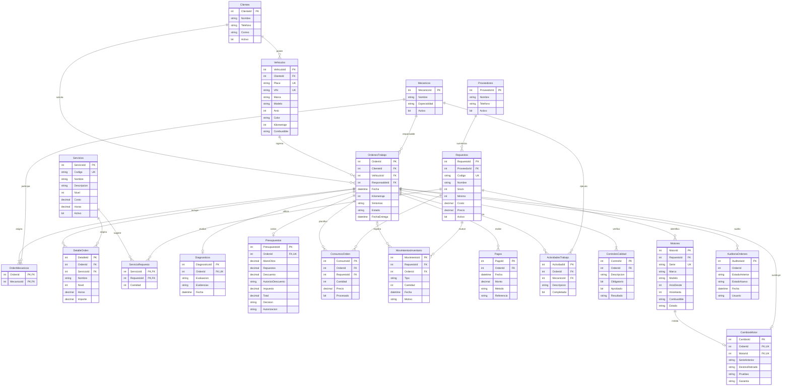
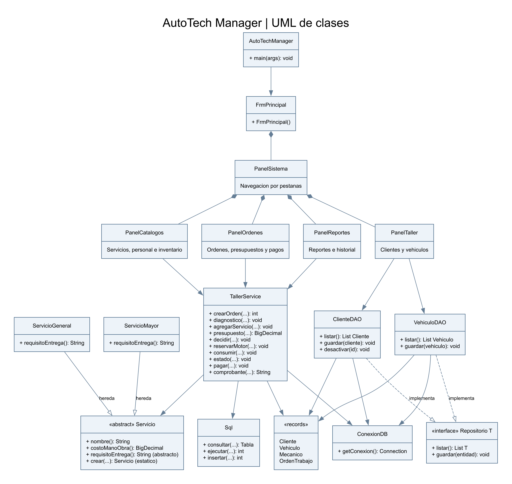
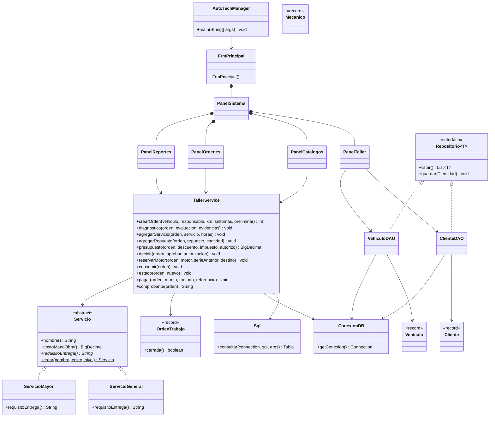

# Diagramas de AutoTech Manager

Los diagramas se visualizan directamente en GitHub. Se corresponden con los scripts SQL 01 y 02 y las clases Java del proyecto.

## Entidad-relación

[Imagen PNG](diagrama-er.png) · [Versión SVG ampliable](diagrama-er.svg) · [Fuente Graphviz](diagrama-er.dot)

AuditoriaOrdenes conserva el identificador de la orden como dato de auditoría, sin clave foránea. Las parejas (OrdenId, ServicioId) y (OrdenId, RepuestoId) son únicas en DetalleOrden y ConsumosOrden. Las cardinalidades mínimas describen los registros creados por el programa; las tablas puente tienen claves compuestas.

## UML de clases

[Imagen PNG](diagrama-uml.png) · [Versión SVG ampliable](diagrama-uml.svg) · [Fuente Graphviz](diagrama-uml.dot)

Mecanico se utiliza al validar personal activo y disponible. Los catálogos actuales muestran resultados tabulares de JDBC mediante Sql.Tabla. La herencia de Servicio sí se utiliza al agregar servicios: cada subtipo genera requisitos de entrega diferentes en la actividad de trabajo.
