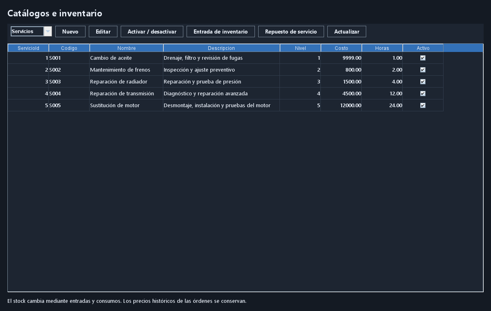
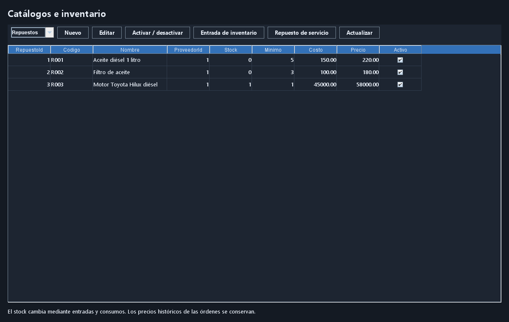
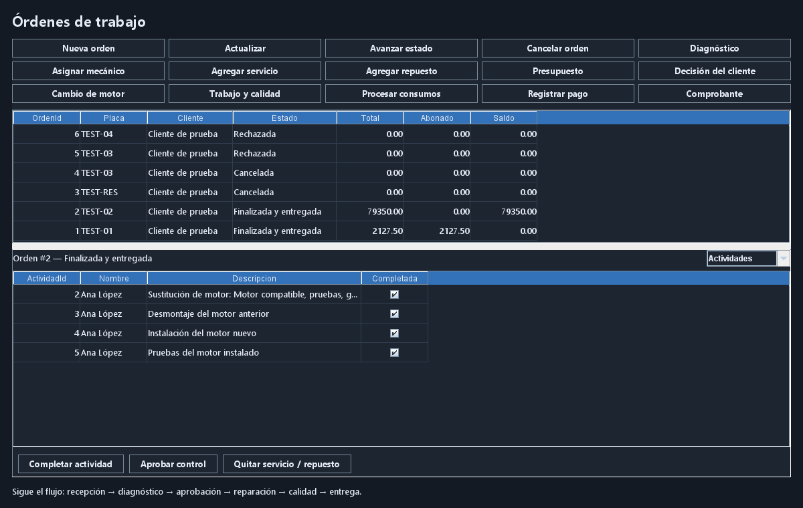
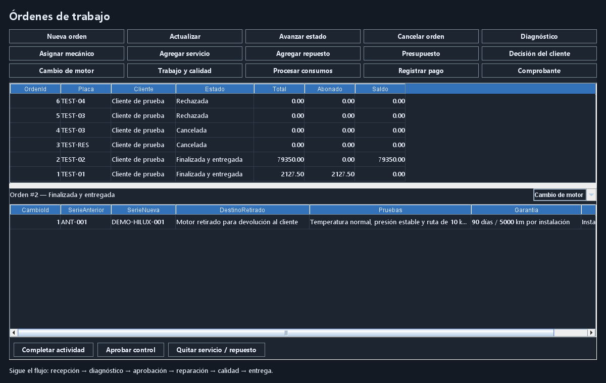
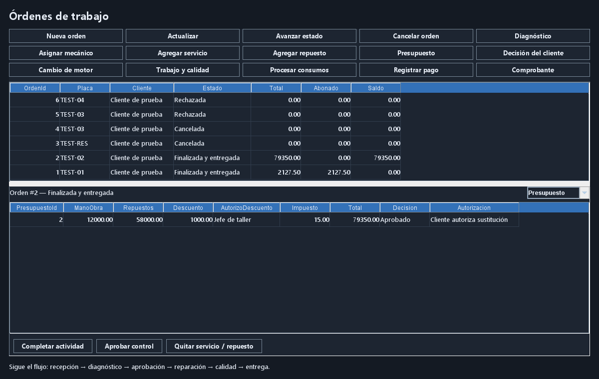
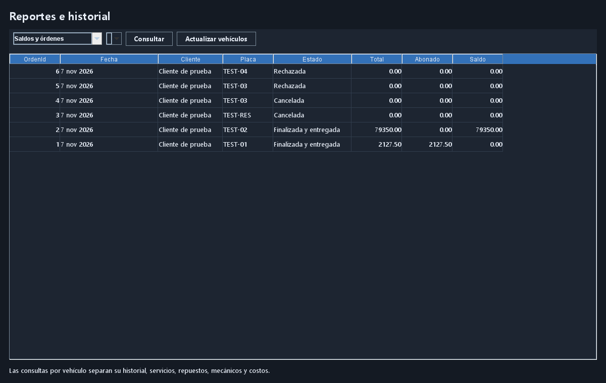

# AutoTech Manager

**Examen práctico del segundo parcial · Programación Avanzada II**  
Sistema de gestión para taller mecánico · Java, JDBC y SQL Server

**Integrantes:** completar los nombres del equipo antes de entregar.  
**Repositorio:** https://github.com/6erson/AutoTechManager

## Propósito y alcance

Centralizar clientes, vehículos, servicios, mecánicos, repuestos, órdenes, presupuestos y pagos. La interfaz de escritorio usa una paleta oscura y cuatro secciones principales para mantener una navegación sencilla.

El sistema cubre un servicio básico y el caso obligatorio de sustitución de motor de una Toyota Hilux 2015. El presupuesto guarda los precios de cada orden, el inventario se descuenta de manera transaccional y los pagos conservan el saldo sin permitir sobrepagos.

## Arquitectura y base de datos

Se separaron presentación, negocio, datos y modelos. Se aplicaron interfaces de persistencia, clases abstractas, herencia, polimorfismo, colecciones, manejo de excepciones y operaciones en segundo plano con SwingWorker. SQL Server contiene relaciones, restricciones, tres procedimientos almacenados, dos vistas y un trigger de auditoría.

Los [diagramas entidad-relación y UML](Diagramas.md) acompañan esta entrega en PNG, SVG y fuentes editables. El [manual técnico](Manual-tecnico.md) describe las reglas y la instalación.

## Capturas de la aplicación

Las imágenes siguientes son capturas renderizadas de los paneles Swing reales con datos de una base separada de pruebas. No representan registros de clientes reales.

### Catálogo de servicios

Servicios clasificados por nivel, con descripción, mano de obra, horas y estado. La prueba cambió el costo de aceite a 9999 para verificar que la orden anterior conserva su precio original.

### Inventario

Entradas y consumos controlan el stock, el mínimo y los precios. El stock de prueba refleja las operaciones del arnés automatizado.

### Actividades de una orden

La tabla superior permite seleccionar la orden y la inferior muestra su detalle: servicios, repuestos, diagnóstico, presupuesto, personal, actividades, calidad, motor, pagos o auditoría.

### Cambio de motor

Se conserva serie anterior/nueva, destino del retirado, pruebas y garantía. La reserva valida compatibilidad por marca, modelo, año y combustible.

### Presupuesto

La orden de motor de prueba presenta L 12000 de mano de obra, L 58000 de motor, descuento autorizado de L 1000 e impuesto del 15%, para un total de L 79350.

### Reportes

Se consultan cuentas, existencias bajas, movimientos, ingresos, disponibilidad e historial separado por vehículo.

## Validación y demostración

Se aprobaron **34 comprobaciones de integración**, incluyendo los dos recorridos de defensa, rollback por falta de stock y pruebas de concurrencia en consumos/pagos. [Resultados y límites de la verificación](Pruebas.md).

El [guion de defensa](Guion-defensa.md) detalla el registro de un cliente con dos vehículos, la reparación básica y la sustitución de motor. El comprobante es interno e imprimible; no se usa JasperReports. Evidencias, autorizaciones y garantía se registran como texto.
